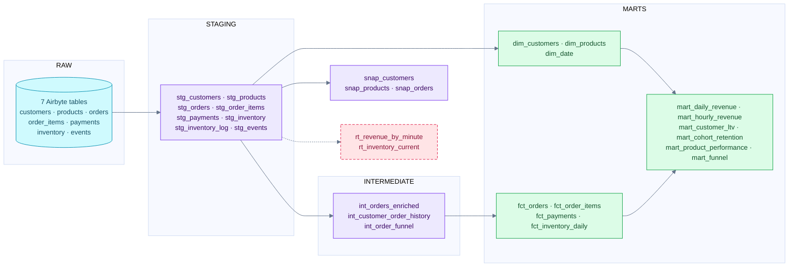

# ShopSphere Analytics Engine

A **Modern Data Stack** pipeline that streams an e-commerce OLTP database into Snowflake with
**Postgres CDC via Airbyte**, models it with **dbt** into a tested star schema, orchestrates it with
**Dagster**, and serves near-real-time analytics through **Dynamic Tables** and **Streamlit**.

> **"Real time" here means near-real-time.** Airbyte CDC is micro-batch (5-15 min cycles). Dynamic Tables remove
> dbt's batch latency on the hottest metrics. Sub-minute latency needs Debezium + Kafka + Snowpipe Streaming (see roadmap).

```mermaid
%%{init: {"theme": "base", "themeVariables": {"primaryTextColor": "#0F172A", "lineColor": "#64748B", "fontSize": "15px"}, "flowchart": {"curve": "basis", "nodeSpacing": 40, "rankSpacing": 55}}}%%
flowchart LR
    subgraph SRC["1. SOURCE"]
        PG[("<b>PostgreSQL</b><br/>OLTP · shop schema")]
    end

    subgraph ING["2. INGESTION"]
        AB["<b>Airbyte</b><br/>CDC · Append mode"]
    end

    subgraph SNOW["3. SNOWFLAKE"]
        RAW[("<b>RAW</b><br/>CDC change log")]

        subgraph DBT["dbt transformation"]
            STG["<b>STAGING</b><br/>dedupe by LSN"]
            INT["<b>INTERMEDIATE</b><br/>business logic"]
            MARTS[("<b>MARTS</b><br/>star schema · contracts · tests")]
            SNAP["<b>SCD2 snapshots</b><br/>history"]
        end

        DT["<b>Dynamic Tables</b><br/>opt-in · 5 min lag"]
    end

    subgraph SERVE["4. SERVING"]
        BI["<b>Streamlit dashboards</b>"]
    end

    ORCH{{"<b>Dagster</b><br/>schedules · freshness · alerts"}}

    PG -- "WAL / pgoutput" --> AB
    AB --> RAW
    RAW --> STG --> INT --> MARTS
    STG --> SNAP
    STG --> DT
    MARTS --> BI
    DT --> BI

    ORCH -. "triggers sync" .-> AB
    ORCH -. "dbt build + tests" .-> DBT
    ORCH -. "slot lag checks" .-> PG

    classDef source fill:#E0F2FE,stroke:#0284C7,stroke-width:2px,color:#0C4A6E
    classDef ingest fill:#FEF3C7,stroke:#D97706,stroke-width:2px,color:#78350F
    classDef raw fill:#CFFAFE,stroke:#0891B2,stroke-width:2px,color:#164E63
    classDef model fill:#EDE9FE,stroke:#7C3AED,stroke-width:2px,color:#3B0764
    classDef mart fill:#DCFCE7,stroke:#16A34A,stroke-width:3px,color:#14532D
    classDef rt fill:#FFE4E6,stroke:#E11D48,stroke-width:2px,stroke-dasharray:5 3,color:#881337
    classDef serve fill:#FCE7F3,stroke:#DB2777,stroke-width:2px,color:#831843
    classDef orch fill:#F1F5F9,stroke:#475569,stroke-width:2px,color:#0F172A

    class PG source
    class AB ingest
    class RAW raw
    class STG,INT,SNAP model
    class MARTS mart
    class DT rt
    class BI serve
    class ORCH orch

    style SRC fill:#F0F9FF,stroke:#BAE6FD,stroke-width:1px,color:#075985
    style ING fill:#FFFBEB,stroke:#FDE68A,stroke-width:1px,color:#92400E
    style SNOW fill:#F8FAFF,stroke:#C7D2FE,stroke-width:1px,color:#3730A3
    style DBT fill:#FAF5FF,stroke:#DDD6FE,stroke-width:1px,color:#5B21B6
    style SERVE fill:#FDF2F8,stroke:#FBCFE8,stroke-width:1px,color:#9D174D
```



## Highlights

- **Correct CDC semantics:** *Append* mode keeps the full change log; dbt dedupes by Postgres LSN, tracks deletes,
  and builds SCD2 history (ADR 001).
- **Production patterns:** key-pair auth, least-privilege RBAC, resource monitors, per-workload warehouses,
  tag-based PII masking, environment isolation (dev / prod), model contracts, source freshness SLAs,
  incremental `merge` facts with late-arrival lookback, dbt unit tests.
- **Observability:** replication-slot WAL monitoring (the real CDC failure mode), daily Postgres-vs-Snowflake
  reconciliation, Slack alerts on any failed run, runbooks for each failure class.
- **Reproducible demo:** a traffic generator exercises INSERT / UPDATE / DELETE so CDC is genuinely tested.

## Repository layout
```text
shopsphere-analytics-engine/
├── Makefile                          Every operation is a make target
├── docker-compose.yml                Local Postgres (logical replication) + traffic generator
├── .env.example                      All configuration variables (copy to .env)
├── requirements/                     dbt.txt · dev.txt · bi.txt
│
├── source_db/                        STAGE 1: source system
│   ├── ddl/
│   │   ├── 01_schema.sql             OLTP tables, triggers, indexes
│   │   └── 02_cdc.sql                CDC role, REPLICA IDENTITY, publication, slot
│   └── generator/                    Faker traffic: inserts, updates, deletes, funnel events
│       ├── generator.py
│       ├── Dockerfile
│       └── tests/
│
├── infra/snowflake/sql/              STAGE 2: Snowflake foundation (idempotent)
│   ├── 01_account_objects.sql        Roles, databases, warehouses, resource monitor
│   ├── 02_grants.sql                 Least-privilege grants, schema layout
│   ├── 03_service_users.sql          Key-pair service users
│   ├── 04_governance.sql             PII tag + masking policy
│   └── 90_enable_change_tracking.sql Needed for Dynamic Tables
│
├── airbyte/                          STAGE 3: ingestion
│   ├── apply_airbyte.py              Creates source, destination, connection via API
│   └── tests/
│
├── dbt/                              STAGE 4: transformation
│   ├── dbt_project.yml · profiles.yml · packages.yml · selectors.yml
│   ├── macros/                       cdc_latest (dedupe by LSN), schema naming, PII tagging
│   ├── models/
│   │   ├── staging/                  stg_* : latest row per key, delete flags
│   │   ├── intermediate/             orders enriched, customer history, session funnel
│   │   └── marts/
│   │       ├── dim_*  fct_*          Star schema (contracts on fct_orders, dim_customers)
│   │       ├── mart_*                Revenue, LTV, cohorts, products, funnel
│   │       ├── _semantic.yml         Governed metrics (MetricFlow)
│   │       └── realtime/             Dynamic Tables (opt-in)
│   ├── snapshots/                    SCD2 history: customers, products, orders
│   └── tests/                        Business-rule tests
│
├── orchestration/                    STAGE 5: orchestration + monitoring
│   └── shopsphere_orchestration/
│       ├── assets.py                 Airbyte sync asset + dbt assets
│       ├── resources.py              Airbyte, Postgres, Snowflake resources
│       ├── monitoring.py             Slot-lag check, Postgres vs Snowflake reconciliation
│       └── definitions.py            Jobs, schedules, Slack failure sensor
│
├── bi/streamlit_app/app.py           STAGE 6: dashboards (read-only REPORTER role)
│
├── scripts/
│   ├── gen_keys.sh                   Generate key pairs for service users
│   └── snowflake_sql.py              Runs the bootstrap SQL with ${ENV} substitution
│
└── docs/
    ├── IMPLEMENTATION_RUNBOOK.md     Gated, step-by-step build guide
    ├── architecture.md
    ├── runbooks/                     slot lag · failed sync · schema drift · full re-sync
    └── adr/                          Architecture decision records
```
### dbt model lineage
 


> **Implementing it?** Follow the gated, step-by-step [Implementation Runbook](docs/IMPLEMENTATION_RUNBOOK.md).

## Prerequisites
 
| Requirement | Notes |
|---|---|
| Docker with Compose v2 | Runs the source Postgres and the traffic generator |
| Python 3.10 to 3.12 | For dbt, Dagster, scripts, Streamlit |
| OpenSSL | Generates service-user key pairs |
| Snowflake account with `ACCOUNTADMIN` | **Enterprise edition** for tag-based PII masking. On Standard, skip `04_governance.sql` and the PII post-hooks (see the runbook, step C5) |
| Airbyte | Self-hosted via [`abctl local install`](https://docs.airbyte.com/platform/using-airbyte/getting-started/oss-quickstart) or Airbyte Cloud |
 
## Configure
 
```bash
python3 -m venv .venv && source .venv/bin/activate
pip install -r requirements/dev.txt -r requirements/bi.txt
cp .env.example .env
```
 
Edit `.env`. Three rules prevent most first-run failures:
 
1. **No quotes and no spaces** in values.
2. **Key paths must be absolute** (dbt and Dagster run from subfolders).
3. Use your Snowflake `orgname-accountname` as `SNOWFLAKE_ACCOUNT`.
Fill the Postgres, Snowflake and credential values now. The `AIRBYTE_*` IDs and public keys are filled in during steps 4 and 6.
 
## Execute the pipeline
 
Run the steps in order. Each has a result you should see before moving on. Full detail and troubleshooting are in the
[Implementation Runbook](docs/IMPLEMENTATION_RUNBOOK.md).
 
| Step | Command | What it does | You should see |
|---|---|---|---|
| 1 | `make up` | Starts Postgres 16 with logical replication and creates the `shop` schema | Container healthy |
| 2 | `make cdc-setup` | Creates `airbyte_cdc` role, publication `shopsphere_pub`, slot `airbyte_slot` | One row in `pg_replication_slots` |
| 3 | `make seed` | Runs the traffic generator for 30 s (customers, products, orders, events) | Orders, payments and events in Postgres |
| 4 | `./scripts/gen_keys.sh` | Generates key pairs for `SVC_AIRBYTE`, `SVC_DBT`, `SVC_BI` | Three `*_RSA_PUBLIC_KEY=` lines to paste into `.env` |
| 5 | `make snowflake-bootstrap` | Creates roles, databases, 3 warehouses, resource monitor, service users, masking | Every statement prints `ok` |
| 6 | `make airbyte-plan` then `make airbyte-apply` | Previews, then creates the Postgres CDC source, Snowflake destination and 7-stream connection | `AIRBYTE_CONNECTION_ID=...` to add to `.env` |
| 7 | Sync once (Airbyte UI **Sync now**, or Dagster in step 9) | Initial snapshot, then WAL streaming into `SHOPSPHERE_RAW.AIRBYTE` | Job succeeded; tables populated |
| 8 | `make dbt-deps` then `make dbt-build` | Builds staging, intermediate, marts, snapshots; runs all tests (dev target) | `dbt build` finishes with 0 errors |
| 9 | `make dagster-dev` | Starts Dagster at http://localhost:3000. Run `hot_pipeline_job`, then enable the schedules | Job green; assets linked raw to marts |
| 10 | `make generate` and `make bi` | Continuous traffic, and Streamlit at http://localhost:8501 | Dashboards update as data flows |
 
Promote to production once dev is green:
 
```bash
make dbt-build DBT_TARGET=prod
```
 
**Optional near-real-time layer** (after the first sync):
 
```bash
make enable-change-tracking
cd dbt && dbt build --vars '{enable_realtime: true}' --select tag:realtime
```
 
## Run it day to day
 
Once Dagster is running, the pipeline runs itself.
 
| Job | Schedule (UTC) | Does |
|---|---|---|
| `hot_pipeline_job` | every 15 min | Airbyte sync, source freshness check, `dbt build` of the hot models |
| `daily_full_job` | 03:00 | Everything: all marts, snapshots, full test suite |
| `cdc_health_job` | every 5 min | Fails if the replication slot retains too much WAL or is invalidated |
| `reconciliation_job` | 04:30 | Compares Postgres and Snowflake row counts and amounts |
 
Failures post to Slack when `SLACK_WEBHOOK_URL` is set.
 
**Run things manually**
 
```bash
make dbt-source-freshness                # are the raw tables fresh?
make dbt-build                           # full build (dev target)
cd dbt && dbt build --selector hot_path  # only the hot models
make dbt-docs                            # generate lineage docs
make generate                            # keep producing source traffic
```
 
## Verify the results
 
```sql
-- Raw layer: change log with CDC columns populated
SELECT COUNT(*) AS rows, COUNT(_AB_CDC_LSN) AS with_lsn FROM SHOPSPHERE_RAW.AIRBYTE.ORDERS;
 
-- Marts match the source (within in-flight data of the last ~45 minutes)
SELECT COUNT(*) FROM SHOPSPHERE_ANALYTICS.MARTS.FCT_ORDERS WHERE NOT IS_DELETED;
 
-- Headline numbers
SELECT * FROM SHOPSPHERE_ANALYTICS.MARTS.MART_DAILY_REVENUE ORDER BY ORDER_DATE DESC LIMIT 7;
 
-- PII masking works: REPORTER sees ***MASKED***, TRANSFORMER sees real values
USE ROLE REPORTER;
SELECT EMAIL FROM SHOPSPHERE_ANALYTICS.MARTS.DIM_CUSTOMERS LIMIT 1;
```
 
Prove CDC end to end: insert, update, then delete an order in Postgres, run a sync and a build after each, and watch the
row appear, change, then flip to `is_deleted = true` in `fct_orders`. The raw table keeps every version.
 
| Scenario | Expected |
|---|---|
| Insert / update / delete in Postgres | Appears, changes, or is flagged `is_deleted` after one sync and one build |
| `ALTER TABLE shop.orders ADD COLUMN note text` | Column propagates to RAW; models keep working (see the schema-drift runbook) |
| Pause the pipeline for an hour, then resume | Catches up with no gaps or duplicates |
| `dbt build --full-refresh` | Identical marts (idempotent) |
| Rotate a service key | Set `RSA_PUBLIC_KEY_2`, switch, unset the old key; no downtime |
 
## Monitoring and runbooks
 
| Situation | Runbook |
|---|---|
| WAL growing or slot unhealthy | [docs/runbooks/replication-slot-lag.md](docs/runbooks/replication-slot-lag.md) |
| Airbyte sync failed or stuck | [docs/runbooks/failed-sync.md](docs/runbooks/failed-sync.md) |
| Source schema changed | [docs/runbooks/schema-drift.md](docs/runbooks/schema-drift.md) |
| Rebuild after slot loss or corruption | [docs/runbooks/full-resync-backfill.md](docs/runbooks/full-resync-backfill.md) |
 
Note: `active = false` on the replication slot is normal between Airbyte micro-batches. The alert is on retained WAL, not inactivity.
 
## Quality gate
 
Run one command before every production build:
 
```bash
make check      # dbt deps, black, yamllint, sqlfluff, dbt parse, unit tests
```
 
Deploys are `make dbt-build DBT_TARGET=prod`. There is no CI service to maintain.
 
## First-run checklist
 
Your first run is the acceptance test. These items depend on your accounts and connector versions, so confirm them once:
 
1. **Airbyte API fields.** `make airbyte-plan` shows the payloads. If the API rejects a field, compare it with the connector spec in your Airbyte version; the script prints the API's message.
2. **Raw table names and casing.** dbt sources expect typed tables at `SHOPSPHERE_RAW.AIRBYTE.<TABLE>` with `_AB_CDC_*` columns. Confirm with `DESC TABLE` after the first sync; adjust `dbt/models/staging/_stg__sources.yml` if they differ.
3. **Model contracts** on `fct_orders` and `dim_customers`. If Snowflake reports a different precision, adjust `data_type` in `_marts__models.yml` and the matching casts.
4. **Dynamic Tables** need change tracking on the Airbyte-owned tables (`make enable-change-tracking`). Check `SHOW DYNAMIC TABLES` for `refresh_mode`; some queries fall back to full refresh.
5. **dbt unit test** `stg_orders_keeps_latest_cdc_record_and_flags_deletes` runs inside Snowflake during `dbt build`.
## Cost and performance
 
- Warehouses auto-suspend at 60 s. Airbyte uses `XSMALL`, dbt uses `SMALL`. The resource monitor suspends at 90% of the credit quota.
- Staging views re-scan the CDC log on each build. That is fine at portfolio scale; at production scale make hot staging models incremental and apply retention to the RAW change log.
- Sync cadence is the main cost lever: every sync wakes `LOADING_WH` and `TRANSFORM_WH`.
## Roadmap
 
Debezium + Kafka + Snowpipe Streaming for sub-minute latency; Terraform port (ADR 002); GDPR erasure workflow that
purges RAW and facts; reverse ETL; ML features (churn, recommendations).
