# ShopSphere Analytics Engine

A **Modern Data Stack** pipeline that streams an e-commerce OLTP database into Snowflake with
**Postgres CDC via Airbyte**, models it with **dbt** into a tested star schema, orchestrates it with
**Dagster**, and serves near-real-time analytics through **Dynamic Tables** and **Streamlit**.

> **"Real time" here means near-real-time.** Airbyte CDC is micro-batch (5-15 min cycles). Dynamic Tables remove
> dbt's batch latency on the hottest metrics. Sub-minute latency needs Debezium + Kafka + Snowpipe Streaming (see roadmap).

```mermaid
%%{init: {"theme": "base", "themeVariables": {"primaryTextColor": "#0F172A", "lineColor": "#64748B", "fontSize": "15px"}, "flowchart": {"curve": "basis", "nodeSpacing": 40, "rankSpacing": 55}}}%%
flowchart LR
    subgraph SRC["1. SOURCE"]
        PG[("<b>PostgreSQL</b><br/>OLTP · shop schema")]
    end

    subgraph ING["2. INGESTION"]
        AB["<b>Airbyte</b><br/>CDC · Append mode"]
    end

    subgraph SNOW["3. SNOWFLAKE"]
        RAW[("<b>RAW</b><br/>CDC change log")]

        subgraph DBT["dbt transformation"]
            STG["<b>STAGING</b><br/>dedupe by LSN"]
            INT["<b>INTERMEDIATE</b><br/>business logic"]
            MARTS[("<b>MARTS</b><br/>star schema · contracts · tests")]
            SNAP["<b>SCD2 snapshots</b><br/>history"]
        end

        DT["<b>Dynamic Tables</b><br/>opt-in · 5 min lag"]
    end

    subgraph SERVE["4. SERVING"]
        BI["<b>Streamlit dashboards</b>"]
    end

    ORCH{{"<b>Dagster</b><br/>schedules · freshness · alerts"}}

    PG -- "WAL / pgoutput" --> AB
    AB --> RAW
    RAW --> STG --> INT --> MARTS
    STG --> SNAP
    STG --> DT
    MARTS --> BI
    DT --> BI

    ORCH -. "triggers sync" .-> AB
    ORCH -. "dbt build + tests" .-> DBT
    ORCH -. "slot lag checks" .-> PG

    classDef source fill:#E0F2FE,stroke:#0284C7,stroke-width:2px,color:#0C4A6E
    classDef ingest fill:#FEF3C7,stroke:#D97706,stroke-width:2px,color:#78350F
    classDef raw fill:#CFFAFE,stroke:#0891B2,stroke-width:2px,color:#164E63
    classDef model fill:#EDE9FE,stroke:#7C3AED,stroke-width:2px,color:#3B0764
    classDef mart fill:#DCFCE7,stroke:#16A34A,stroke-width:3px,color:#14532D
    classDef rt fill:#FFE4E6,stroke:#E11D48,stroke-width:2px,stroke-dasharray:5 3,color:#881337
    classDef serve fill:#FCE7F3,stroke:#DB2777,stroke-width:2px,color:#831843
    classDef orch fill:#F1F5F9,stroke:#475569,stroke-width:2px,color:#0F172A

    class PG source
    class AB ingest
    class RAW raw
    class STG,INT,SNAP model
    class MARTS mart
    class DT rt
    class BI serve
    class ORCH orch

    style SRC fill:#F0F9FF,stroke:#BAE6FD,stroke-width:1px,color:#075985
    style ING fill:#FFFBEB,stroke:#FDE68A,stroke-width:1px,color:#92400E
    style SNOW fill:#F8FAFF,stroke:#C7D2FE,stroke-width:1px,color:#3730A3
    style DBT fill:#FAF5FF,stroke:#DDD6FE,stroke-width:1px,color:#5B21B6
    style SERVE fill:#FDF2F8,stroke:#FBCFE8,stroke-width:1px,color:#9D174D
```



## Highlights

- **Correct CDC semantics:** *Append* mode keeps the full change log; dbt dedupes by Postgres LSN, tracks deletes,
  and builds SCD2 history (ADR 001).
- **Production patterns:** key-pair auth, least-privilege RBAC, resource monitors, per-workload warehouses,
  tag-based PII masking, environment isolation (dev / prod), model contracts, source freshness SLAs,
  incremental `merge` facts with late-arrival lookback, dbt unit tests.
- **Observability:** replication-slot WAL monitoring (the real CDC failure mode), daily Postgres-vs-Snowflake
  reconciliation, Slack alerts on any failed run, runbooks for each failure class.
- **Reproducible demo:** a traffic generator exercises INSERT / UPDATE / DELETE so CDC is genuinely tested.

## Repository layout

```
Makefile          every operation is a `make` target; `make check` is the local quality gate
source_db/        DDL, CDC setup SQL, traffic generator (+ tests)
infra/snowflake/  idempotent bootstrap SQL: warehouses, roles, grants, users, masking
airbyte/          apply_airbyte.py (source + destination + connection via API)
dbt/              staging / intermediate / marts / snapshots / tests / semantic layer
orchestration/    Dagster code location (assets, schedules, monitoring)
bi/               Streamlit dashboards
docs/             architecture, runbooks, ADRs
```

> **Implementing it?** Follow the gated, step-by-step [Implementation Runbook](docs/IMPLEMENTATION_RUNBOOK.md).

## Quickstart (local source + your Snowflake account)

Prerequisites: Docker, Python 3.10+, OpenSSL, a Snowflake account (**Enterprise edition** for tag-based masking;
Standard works if you skip `04_governance.sql` and the PII post-hooks), and Airbyte via
[`abctl local install`](https://docs.airbyte.com/platform/using-airbyte/getting-started/oss-quickstart).

```bash
cp .env.example .env                       # fill in values
pip install -r requirements/dev.txt

# 1. Source database with logical replication, then CDC role/publication/slot
make up && make cdc-setup

# 2. Snowflake: keys -> bootstrap
./scripts/gen_keys.sh                      # paste the printed *_RSA_PUBLIC_KEY lines into .env
make snowflake-bootstrap

# 3. Airbyte: create credentials in the UI (abctl local credentials), set AIRBYTE_* in .env, then
make airbyte-plan                          # review (secrets redacted)
make airbyte-apply                         # prints AIRBYTE_CONNECTION_ID -> add to .env

# 4. Seed data, first sync, build models
make seed
#    run one sync (Airbyte UI or Dagster), then:
make dbt-deps && make dbt-build

# 5. Orchestrate and visualise
make dagster-dev                           # http://localhost:3000 (enable the schedules)
make generate &                            # continuous traffic
make bi                                    # Streamlit
```

Before any production build, run the single local quality gate: `make check` (lint, `dbt parse`, unit tests).
There is no CI service to maintain; deploys are `make dbt-build DBT_TARGET=prod`.

Optional near-real-time layer: `make enable-change-tracking`, then
`dbt build --vars '{enable_realtime: true}' --select tag:realtime`.

## Validate end to end

| Test | Expected |
|---|---|
| Insert / update / delete a row in Postgres, run a sync | row appears, changes, or is flagged `is_deleted` in `fct_orders` |
| `ALTER TABLE shop.orders ADD COLUMN note text` | propagates to RAW; models keep working; follow the schema-drift runbook for marts |
| Stop Airbyte for an hour, resume | catches up, no gaps or duplicates in marts (dedupe by LSN) |
| `SESSIONS_PER_SEC=60`, scale generator containers | freshness holds; `cdc_health_job` shows bounded retained WAL |
| `dbt build --full-refresh` | idempotent, identical marts |
| Rotate a service key | update `ALTER USER ... SET RSA_PUBLIC_KEY_2`, switch, then unset the old key; no downtime |

## What has been verified, and what has not

Verified in a sandbox while building this repo:

- Postgres 16: DDL and CDC SQL apply twice without error; generator ran under load and produced INSERT, UPDATE and
  DELETE changes on all CDC tables through a logical slot; a ~3% refund rate and no negative stock.
- `dbt parse` (dbt-core 1.10 / dbt-snowflake 1.10) succeeds with contracts, unit tests, semantic layer and package
  tests; `sqlfluff` (Snowflake dialect) lints all models cleanly; YAML and Python formatting checks pass.
- Dagster definitions load and wire the Airbyte raw assets to the dbt staging models; monitoring logic, Airbyte
  payload builders and generator logic have unit tests; the Snowflake SQL runner renders, splits and redacts correctly.

**Not executable without your accounts**, so please run these once and treat the first run as the acceptance test:

1. **Airbyte API field names.** Connector specs evolve; `airbyte/apply_airbyte.py --dry-run` shows the payloads. If the
   API rejects a field, compare with the spec in your Airbyte version (the script fails loudly with the API message).
2. **Raw table naming/casing.** dbt sources assume Airbyte's Snowflake destination writes typed tables to
   `SHOPSPHERE_RAW.AIRBYTE.<TABLE>` with `_AB_CDC_*` columns. Confirm after the first sync (`DESC TABLE`).
3. **Model contracts** on `fct_orders` / `dim_customers` compare declared types against the query's types; if
   Snowflake reports a different precision, adjust the `data_type` in `_marts__models.yml` and the casts.
4. **Dynamic Tables** require change tracking on Airbyte-owned tables (`make enable-change-tracking`) and may fall
   back to FULL refresh for some query shapes; check `SHOW DYNAMIC TABLES` (`refresh_mode`).
5. **dbt unit test** `stg_orders_keeps_latest_cdc_record_and_flags_deletes` runs inside Snowflake during `dbt build`.

## Cost and performance notes

- Warehouses auto-suspend at 60s; Airbyte on `XSMALL`, dbt on `SMALL`; a resource monitor suspends at 90% of the quota.
- Staging views re-scan the CDC log each build. That is fine at portfolio scale; at production scale convert hot
  staging models to incremental and apply retention to `RAW` (change log) tables.
- Airbyte/Dagster cadence is the main cost lever: every sync wakes `LOADING_WH` and `TRANSFORM_WH`.

## Roadmap

Debezium + Kafka + Snowpipe Streaming for sub-minute latency; Terraform port (ADR 002); GDPR erasure workflow that
purges RAW and facts; reverse ETL; ML features (churn, recommendations).

## License

MIT
