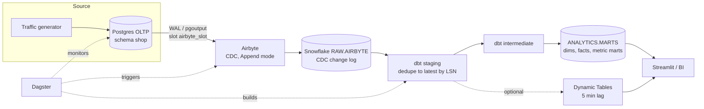

# Architecture

## Data flow

1. **Postgres** is the OLTP source. Logical replication (`wal_level=logical`) exposes all
   changes through publication `shopsphere_pub` and slot `airbyte_slot` using `pgoutput`.
2. **Airbyte** reads the slot in micro-batches and appends every change event to
   `SHOPSPHERE_RAW.AIRBYTE.<table>` (sync mode *Incremental | Append*). Each row carries
   `_ab_cdc_lsn`, `_ab_cdc_updated_at`, `_ab_cdc_deleted_at`, `_airbyte_extracted_at`.
3. **dbt staging** collapses the change log to the latest row per key (`cdc_latest` macro, ordered
   by LSN) and flags deletes. Deleted rows are kept as `is_deleted` so downstream incremental
   facts can soft-delete them.
4. **dbt intermediate/marts** build a star schema plus metric marts. Facts are incremental
   (`merge`) with a 30-minute re-processing window; dimensions and metric marts are tables.
5. **Snapshots** (SCD2) capture history for customers, products and orders.
6. **Dynamic Tables** (opt-in) read the deduped log directly for the freshest revenue and stock views.
7. **Dagster** triggers the Airbyte job, checks source freshness, runs `dbt build`, and runs
   health checks (slot lag, Postgres-vs-Snowflake reconciliation) with Slack alerts.

## Freshness model (be precise about "real time")

| Hop | Typical latency |
|---|---|
| Postgres commit to Airbyte read | one sync interval (Dagster schedule: 15 min; can be 5) |
| Airbyte load to Snowflake | 1-3 min for small batches |
| dbt hot path | 1-3 min |
| Dynamic Tables | `target_lag` (5 min) after data lands, skipping the dbt run |

This is **near-real-time micro-batch**, not streaming. For sub-minute latency the upgrade path is
Debezium + Kafka + Snowpipe Streaming.

## Environments

| Target | Database | Schema |
|---|---|---|
| prod | `SHOPSPHERE_ANALYTICS` | `STAGING`, `INTERMEDIATE`, `MARTS`, `SNAPSHOTS` |
| dev | `SHOPSPHERE_ANALYTICS_DEV` | `dbt_<you>_<layer>` |

All environments read the same `SHOPSPHERE_RAW` (read-only for dbt).

## Security model

| Role | Can |
|---|---|
| `LOADER` | write `SHOPSPHERE_RAW`; used only by Airbyte (key-pair) |
| `TRANSFORMER` | read RAW, own all ANALYTICS objects; used by dbt/Dagster (key-pair) |
| `REPORTER` | read `ANALYTICS.MARTS` only; used by BI (key-pair) |
| `ANALYST` | `REPORTER` + read staging/intermediate views |
| `PII_READER` | see unmasked `email` / `full_name` |

PII columns (in `stg_customers`, `dim_customers` and `snap_customers`) are masked by a tag-based masking policy for everyone except `TRANSFORMER`,
`ACCOUNTADMIN` and `PII_READER`. The `airbyte_cdc` Postgres role has `REPLICATION` + `SELECT` only.
